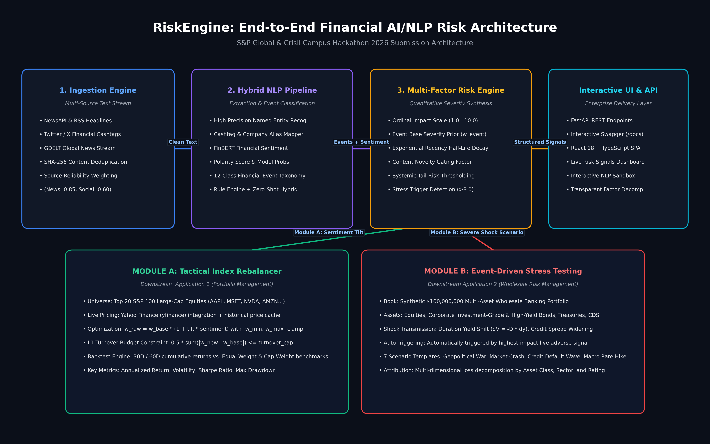

# RiskEngine: AI/NLP Financial Risk Quantification Platform - S&P Global & Crisil Campus Hackathon

**Candidate Name:** Avni Jhalani  
**College Email ID:** j.avni@iitg.ac.in  
**College :** Indian Institute of Technology Guwahati  
**Demo Video Link:** https://youtu.be/wT2fqWCrrIs
**Slide Deck Link:** [docs/presentation.pdf](docs/presentation.pdf) | [docs/presentation.pptx](docs/presentation.pptx)  

---

## 1. Project Overview

**RiskEngine** is an institutional, end-to-end financial intelligence platform that transforms unstructured text (news, social media) into structured, mathematically grounded risk signals and deploys them into **two** downstream quantitative applications:

- **Module A — Tactical Index Rebalancer:** Tilts 20-stock S&P 100 proxy weights according to real-time NLP signals within institutional L1 turnover budgets (default 30%) and concentration bounds [2%, 12%].
- **Module B — Wholesale Portfolio Stress Testing:** Injects event-driven shock scenarios into a synthetic **~$89.92M** 20-position multi-asset banking book with duration-adjusted yield shifts, credit spread widening, and sector-amplified equity shocks.

---

## 2. Architecture & Tech Stack

### System Architecture Flow


### Key Architectural Layers

1. **Ingestion & Deduplication:** Dual-channel ingestion (NewsAPI, Twitter cashtags, GDELT, sample datasets) with **SHA-1** fingerprinting to suppress duplicate wire stories. Source reliability weighting: Reuters/Bloomberg 0.95, NewsAPI 0.75, GDELT 0.70, Kaggle-financial 0.80, Tweets 0.40.

2. **Hybrid NLP Processing Pipeline:**
   - **Named Entity Recognition (NER):** Cashtag (`$AAPL`, `$TSLA`) and company-alias resolution with contextual lookahead filters to eliminate false positives (e.g. "apple pie", "amazon rainforest", "BA flight delayed").
   - **Financial Sentiment Engine:** FinBERT transformer model when `transformers` + `torch` are installed; automatic lexicon fallback otherwise. Both produce identical API contracts (labelled via `/health`).
   - **14-Class Financial Event Taxonomy:** Geopolitical, Macroeconomic, Credit Event, Merger & Acquisition, Earnings, Product Launch, Regulatory, Legal, Supply Chain, Management Change, Cybersecurity, Market Shock, Commodity Shock, Other.

3. **Multi-Factor Risk Signal Engine:**

   ```
   raw    = (0.60 × severity + 0.40 × |sentiment|) × f_conf × f_rel × f_mkt × f_nov × f_rec
   impact = clamp(1.0 + 9.0 × raw^0.70, 1.0, 10.0)
   ```

   Each modulator `f_x = floor_x + (1 − floor_x) × x` so no single weak factor zeroes a signal. Auto-triggers stress test for adverse signals with `impact ≥ 7.0`.

4. **Downstream Applications (Module A & B):**
   - **Module A:** 20-stock universe, live `yfinance` prices, weight formula `w_i ∝ w_base_i × (1 + α × sentiment_i) × vol_adj_i`, iterative clamping, L1 turnover constraint.
   - **Module B:** ~$89.92M banking book — 5 corporate loans, 3 government bonds, 4 corporate bonds, 4 equities, 3 derivatives, 1 cash — duration DV01 yield shifts, credit spread DV01, stressed expected loss, FX, and commodity vol shocks.

5. **Interactive UI Workstation:** React 18, TypeScript, Vite, Recharts, dark-mode, served via FastAPI static mount.

### Tech Stack
| Layer | Technology |
|---|---|
| Backend | Python 3.10+, FastAPI, Uvicorn, Pydantic V2, Starlette |
| Quantitative | NumPy, Pandas, Scikit-learn, yfinance, RapidFuzz |
| Frontend | React 18, TypeScript, Vite, Recharts, Lucide Icons, Vanilla CSS |
| Testing | Pytest (165 unit & integration tests) |

---

## 3. Datasets Used

1. **Sample Benchmark Feeds (`data/sample/`):**
   - `news_sample.jsonl`: Curated financial news across technology, banking, energy, and healthcare sectors.
   - `tweets_sample.jsonl`: Social media stream with financial cashtags.
2. **Live Market Data:** Real-time prices, 30-day volatility, historical returns from Yahoo Finance (`yfinance`). Graceful offline fallback to bundled synthetic history.
3. **Synthetic Wholesale Banking Book (`app/stress_testing/portfolio.py`):** ~$89.92M across 20 positions. All positions clearly labelled SIMULATED.
4. **Data Integrity:** No proprietary data. No fabricated performance numbers. Impact scores are ordinal severity indices, not price forecasts.

---

## 4. Quickstart & Installation

**Tested Environment:** Python 3.10+ on Windows 11 & Linux | Node.js 18+ (Frontend is pre-compiled in `dist/`, so Node is optional for running).

### Step 1: Clone
```bash
git clone <your-repo-url>
cd <repo-folder>
```

### Step 2: Install Python Dependencies
```bash
pip install -r requirements.txt
```

> **Optional — FinBERT transformer model:**
> ```bash
> pip install transformers torch
> ```
> Without this, the NLP pipeline uses a financial lexicon fallback (disclosed at `/health`).

### Step 3: Run Test Suite
```bash
python -m pytest
```
Expected: **165 passed** in ~8–10 seconds.

### Step 4: Launch Application
```bash
python run.py
```

### Step 5: Access Interfaces
| Interface | URL |
|---|---|
| Interactive Web Dashboard | http://localhost:8000 |
| Swagger API Documentation | http://localhost:8000/docs |
| Health Check (model info) | http://localhost:8000/health |

*(Optional) Frontend hot-reload dev mode:*
```bash
cd riskengine/frontend
npm install && npm run dev
# http://localhost:5173
```

---

## 5. Key Results & Domain Impact

### Technical Outputs
- **165 Automated Tests:** Covers scoring mathematical invariants (weights sum to 1.0, non-negative portfolio valuations, monotonic loss attribution, ticker disambiguation).
- **Module A:** Produces sentiment-adjusted weight allocations with documented reasoning per holding. Turnover is strictly capped at the configured budget. Backtest computes cumulative returns vs. equal-weight and cap-weight benchmarks.
- **Module B:** Provides position-level shock breakdown (equity, rate, credit spread, expected loss, FX, commodity) plus aggregated loss attribution by asset class, sector, geography, and credit rating.
- **NLP Sandbox:** Real-time pipeline factor breakdown for any arbitrary news text or tweet.

### Domain Impact for S&P Global & Crisil
- **Automated Credit Intelligence:** Structured early-warning risk indicators from high-velocity news.
- **Dynamic Scenario Actuation:** Geopolitical/macroeconomic headlines auto-trigger portfolio stress simulations.
- **Enterprise Traceability:** Every weight shift or stressed dollar loss traces back to the source text, SHA-1 fingerprint, and mathematical factor decomposition.

---

## 6. Submission Deliverables Index

| Deliverable | Repository Path | Description |
|---|---|---|
| Source Code | `/riskengine` | Full working backend & frontend |
| Architecture Diagram | [`docs/architecture.png`](docs/architecture.png) | High-resolution system flow diagram |
| Presentation Deck (PDF) | [`docs/presentation.pdf`](docs/presentation.pdf) | 7-slide official submission deck |
| Presentation Deck (PPTX) | [`docs/presentation.pptx`](docs/presentation.pptx) | Editable PowerPoint |
| Sample Datasets | `/data/sample/` | News and social cashtag feeds |
| License | [`LICENSE`](LICENSE) | MIT License |
